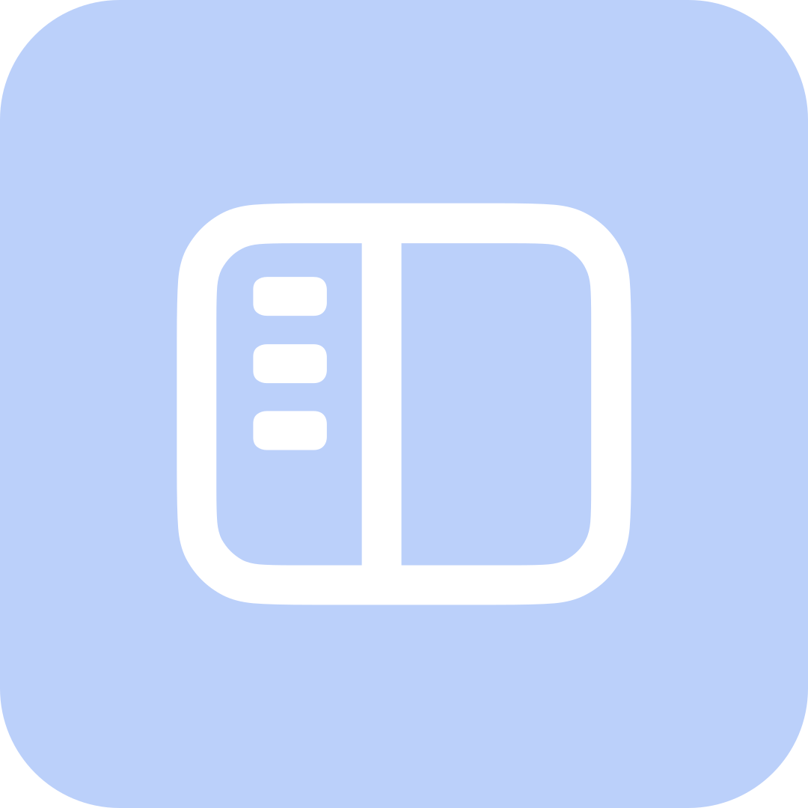

<div align="center">



# HyperDock

**为澎湃 OS3/4 打造的侧边栏（全局 Dock）增强模块**

[](https://github.com/1812z/HyperDock/releases)

[](LICENSE)
[](https://android.com)
[](https://github.com/LSPosed/LSPosed)
[](https://hyperos.mi.com)
[](https://developer.android.com/compose)

</div>

---

## ✨ 功能介绍

<table>
<tr>
<td width="50%">

### 🪟 自动展开面板
侧边栏滑出时直接展开全部应用面板，与侧边栏作为一个整体动画，无需二次点击。

</td>
<td width="50%">

### 🧩 栏目自定义
自由选择全部应用面板中显示的栏目并调整顺序，面板完全按你的习惯来。

</td>
</tr>
<tr>
<td width="50%">

### 🌊 错位展开
全部应用面板以独立动画展开，与侧边栏形成错位的层次感。

</td>
<td width="50%">

### ⚡ 面板预加载
保留已初始化的面板实例，加快侧边栏后续打开速度。

</td>
</tr>
<tr>
<td width="50%">

### 📱 全部应用自定义
白名单 / 黑名单两种模式，自由控制全部应用面板中显示的应用。

</td>
<td width="50%">

### 🧭 快捷方式
将系统开关、第三方磁贴、任意 Activity 添加到侧边栏，支持自定义排序与点击后自动收起侧边栏。

</td>
</tr>
<tr>
<td width="50%">

### 🏝️ HyperIsland 联动
一键触发 [HyperIsland](https://github.com/1812z/HyperIsland) 的录屏岛与实况录制。

</td>
<td width="50%">

### 🚀 快速启动
从侧边栏直接启动选定应用的任意 Activity，常用功能一步直达。

</td>
</tr>
</table>

---

## 📦 使用

1. 安装 APK 并在 LSPosed 中启用模块
2. 勾选作用域：**安全中心（com.miui.securitycenter）** 与 **系统界面（com.android.systemui）**
3. 重启系统界面与安全中心进程，滑出侧边栏即可体验

---

## 🔨 构建

确保已安装 JDK 21 和 Android SDK，然后运行：

```bash
./gradlew :app:assembleRelease
```

---

## Star History

<a href="https://star-history.dera.page/#1812z/HyperDock&type=date&legend=top-left">
 <picture>
   <source media="(prefers-color-scheme: dark)" srcset="https://star-history.dera.page/svg?repos=1812z/HyperDock&type=date&theme=dark&legend=top-left" />
   <source media="(prefers-color-scheme: light)" srcset="https://star-history.dera.page/svg?repos=1812z/HyperDock&type=date&legend=top-left" />
   
 </picture>
</a>

---

## 📄 许可证

本项目基于 [MIT License](LICENSE) 开源，欢迎 Issue 与 PR。

<div align="center">

Made with ❤️ for HyperOS users

[](https://github.com/1812z/HyperDock)

</div>


## 本仓库说明（AbelDuan）

- 上游：https://github.com/1812z/HyperDock
- 基线：`main` @ `67a5922afa57b3046da176eb5433e02c5fd93455`（v1.2）
- 双列侧边栏来自上游 PR #2 `feat/sidebar-two-columns-and-autoclose`（merge commit `e82d5e39`），该 PR 已包含在上述基线中；本仓库保留完整提交内容，并提供可直接编译的 Actions 工作流。
- 相关文件：`app/src/main/java/io/github/z1812/hyperdock/xposed/hook/Sidebar/SidebarColumnsHook.kt`、`SidebarDockSlotHook.kt`、`compose/page/settings/QuickSlotPage.kt`。
- 构建：Actions → `build-dualcolumn` → Run workflow；产物为 `hyperdock-dualcolumn` artifact。

## 本仓库改动：系统应用过滤与应用排序

### 系统应用过滤
- 配置 `all_apps_show_system`（默认 `true`），**只在黑名单模式生效**；白名单模式忽略该开关，设置页也隐藏它。
- 名单勾选页始终列出全部应用：系统应用是否显示与名单内容无关，系统应用同样可以加入黑名单。
- 关闭该开关后，侧边栏全部应用列表先隐藏所有系统应用，再叠加黑名单规则。
- 判定同时使用 `FLAG_SYSTEM` 与 `FLAG_UPDATED_SYSTEM_APP`。

### 最近应用置顶
- 两个独立勾选项：`all_apps_recent_open_enabled`（最近打开）与 `all_apps_recent_task_enabled`（最近任务中的 APP），可同时勾选；`all_apps_recent_order` 保存用户用箭头调整的先后顺序。
- 最近数据源：`UsageStatsManager.lastTimeUsed`（最近打开）与 `ActivityManager.getRecentTasks` 反射（最近任务），Hook 运行在安全中心进程，具备相应权限；结果按包名去重并缓存 20 秒。
- 勾选的来源按顺序合并后置顶，**绕过黑白名单及系统应用过滤**，无论名单如何设置都显示在最前面；其余应用保持原生相对顺序。
- 旧的单选配置 `all_apps_sort_mode` 在 App 启动时一次性迁移到新键后删除。
- 数据源文件：`xposed/hook/Sidebar/SidebarRecentApps.kt`。
- 修复：`inject()` 的无栏目配置早退分支原先直接返回未排序的 `filtered`，导致排序不生效；现在该分支也返回排序后的应用列表。
- 修复：名单/系统应用过滤原先作用于整份列表，会把原生“快捷功能”段里的系统项一起隐藏，导致点击添加后闪一下消失；现在只对“全部应用”段过滤，快捷功能段原样保留。
- 修复：原生侧边栏进入编辑态时（`SidebarEditGuard`），暂停自定义重排/槽位注入，原样放行宿主列表，避免添加系统快捷方式时闪一下退出编辑模式。

### 固定签名
- 发布密钥：`tooling/keys/hyperdock-release.jks`（PKCS12，alias `hyperdock`，store/key 密码 `hyperdock2026`，证书 SHA-256 `41:06:A7:50:FF:AD:84:C9:E0:32:DE:07:C5:A2:B3:32:3C:D5:DC:5B:C9:C1:46:3A:36:38:7D:B9:AA:84:13:6F`）。
- CI 的 `Use checked-in release key` 步骤把它注入 `KEYSTORE_PATH` 等环境变量，之后每次构建都用同一把钥匙签 `releaseFast`；不要再回退到 runner 的 Android Debug 签名。

## 全部应用面板列数

- 侧边栏本体固定两列，不受此项影响。
- 新增 `all_apps_panel_columns_inner` / `all_apps_panel_columns_outer`（0=系统默认，3–6=自定义）。
- 展开侧边栏后的“最近应用/所有应用”列表按当前屏读对应列数；Hook 挂在 `com.miui.dock.drag.DockShortCutMenu.d` 拿到面板 RecyclerView，替换为 GridLayoutManager，并按列数均分 item 宽度。
- 设置项位于「设置 → 全部应用」，不在「行为」页。
- 侧边栏本体固定两列；全部应用面板展开时不再让 dock 回退单列，避免闪烁。

## 常驻小窗候选

- 「速记旁的图标」的内置快捷方式候选改为使用 SystemUI 实探目录（`ShortcutCatalog.all`），与“快捷方式”页一致；此前只列内置写死的 QS 表，本机实际支持的快捷功能缺失，表现为无法添加到常驻小窗。

## 固定四列与默认展开（本仓库改动）

- 应用面板固定 4 列，内外屏一致；不再提供列数设置，避免 5 列被宿主写回 6 列。
- 只改应用面板自身的宽度和 item 宽度，不动 TurboLayout/侧边栏兄弟节点，保证侧边栏贴边。
- 侧边栏滑出默认展开全部应用；检测到音频/视频/会议/游戏等工具箱面板时跳过。
- 一次性迁移把 `sidebar_expand_all_apps` 打开；用户之后仍可在设置里关闭。
